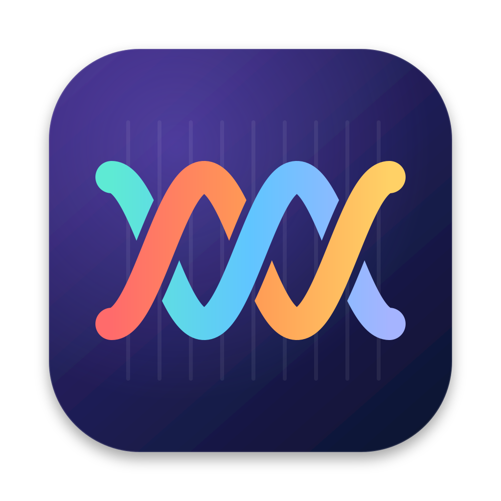
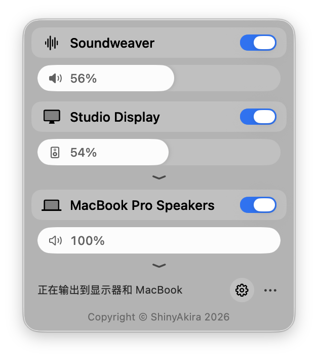
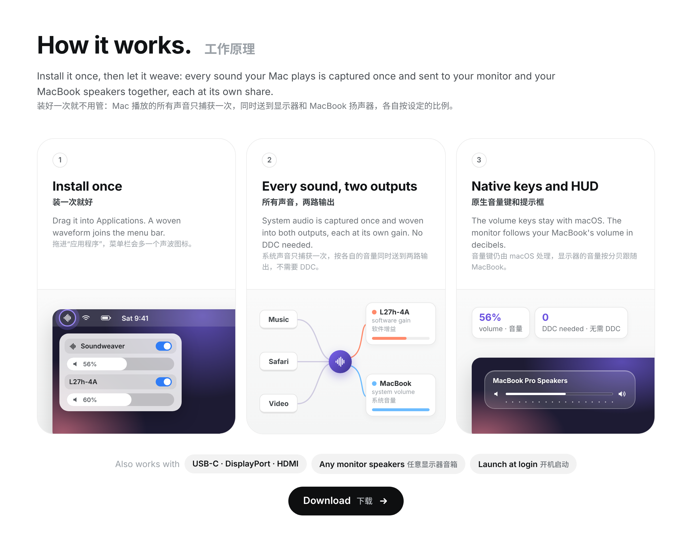

<p align="center"></p>

# Soundweaver

<p align="center">
  <a href="LICENSE"></a>
  
  
  <a href="https://github.com/ShinyAkira106/Soundweaver/releases"></a>
  <a href="https://github.com/ShinyAkira106"></a>
</p>

简体中文 · English（界面为简体中文 / interface in Simplified Chinese）

一个 macOS 菜单栏小工具：让键盘音量键同时控制外接显示器和 MacBook 扬声器。声音通过 USB-C、DisplayPort 或 HDMI 送到显示器时，macOS 调不了它的音量，很多显示器的耳机口也不理会 DDC 设置的音量。Soundweaver 把 Mac 播放的声音捕获下来，按各自的比例同时送到显示器和 MacBook 扬声器，送往显示器的音量直接在软件里调整，接在显示器上的音箱一定会跟着变。音量键、静音键和系统原生的音量提示框都和平常完全一样。

A macOS menu bar app that lets the volume keys control an external monitor and the MacBook speakers together. When audio goes to a monitor over USB-C, DisplayPort or HDMI, macOS cannot change its volume, and many monitors' headphone jacks ignore the volume set over DDC as well. Soundweaver captures what your Mac plays and sends it to the monitor and the MacBook speakers at the same time, each at its own share, with the monitor's level applied in software, so speakers plugged into the monitor always follow. The volume keys, the mute key and the native system volume HUD work exactly as usual.

<p align="center">
  
</p>

菜单栏里的 Soundweaver 面板。

The Soundweaver panel in the menu bar.

## 安装 / Install

从 [Releases](https://github.com/ShinyAkira106/Soundweaver/releases) 下载 `Soundweaver-1.6.0.dmg`，打开后把 Soundweaver 拖进“应用程序”文件夹。软件混音需要 macOS 14.2 或更新版本。由于应用没有经过苹果公证，第一次打开时如果被系统拦下，请到“系统设置 > 隐私与安全性”最下面点“仍要打开”。

Download `Soundweaver-1.6.0.dmg` from [Releases](https://github.com/ShinyAkira106/Soundweaver/releases), open it and drag Soundweaver into Applications. The software mix needs macOS 14.2 or later. The app is not notarized by Apple, so if macOS stops it on first launch, click Open Anyway at the bottom of System Settings > Privacy & Security.

第一次启动时，macOS 会请求“系统录音”权限，请点允许。如果错过了，可以到“系统设置 > 隐私与安全性 > 屏幕与系统录音”，在“仅系统录音”下打开 Soundweaver，它会在几秒内自动开始工作。Soundweaver 只在本机实时处理声音，不会保存或上传。然后用显示器自己的按键把显示器音量调到最大，之后显示器的音量就交给 Soundweaver 控制。

On first launch macOS asks for the System Audio Recording permission; click Allow. If you miss it, go to System Settings > Privacy & Security > Screen & System Audio Recording and turn on Soundweaver under System Audio Recording Only; it starts within a few seconds. Soundweaver only processes audio live on your Mac and never saves or uploads it. Then turn the monitor's own volume all the way up with its buttons, and let Soundweaver control it from there.

菜单栏右上角会多一个声波图标。点开是一个和控制中心风格一致的面板：最上面是 Soundweaver 总开关和总音量（也就是 MacBook 的系统音量）；下面是显示器卡片，开关只静音显示器，滑块调整显示器的比例，展开后可以设置显示器音量上限；再下面是 MacBook 卡片，开关决定 MacBook 扬声器是否一起出声，展开后可以调整两边的同步补偿。右下角的齿轮打开完整设置，省略号菜单里有重新检测设备、预览提示框、检查更新和退出。

A waveform icon appears in the menu bar. It opens a panel styled like Control Center: the Soundweaver master switch and master volume (which is the MacBook's system volume) on top; then the monitor card, whose switch mutes only the monitor and whose slider sets its share, with a monitor volume cap when expanded; then the MacBook card, whose switch decides whether the MacBook speakers play too, with a sync offset when expanded. The gear opens the full settings, and the ellipsis menu holds rescan, HUD preview, update check and quit.

## 界面一览 / Screenshots

<p align="center">
  
</p>

设置窗口：左边是图标和“重新检测设备”按钮，右边是八个设置主题，点进去可以做细节调整。

The settings window: the icon and a Rescan button on the left, and eight topics on the right that open detail pages.

## 功能 / Features

### 软件混音 / Software mix

Soundweaver 用 macOS 的系统音频捕获功能拿到所有应用播放的声音，再同时送到 MacBook 扬声器和显示器，每一路都有自己的音量。送往显示器的声音在软件里调低，不依赖 DDC，所以不管显示器的耳机口是否跟随显示器音量，接在上面的音箱都会跟着变。关掉显示器卡片的开关，显示器那一路会真正静音，MacBook 继续出声；关掉 MacBook 卡片的开关，就只剩显示器出声。

Soundweaver uses macOS's system audio capture to take the sound every app plays and send it to the MacBook speakers and the monitor at the same time, each with its own level. The monitor's audio is turned down in software instead of over DDC, so speakers on the monitor follow whether or not its headphone jack tracks the monitor's own volume. Turning off the monitor card's switch really silences the monitor while the MacBook keeps playing; turning off the MacBook card's switch leaves only the monitor.

### 原生音量键和提示框 / Native keys and HUD

系统输出始终保持在 MacBook 扬声器上，所以 F10、F11、F12 完全由 macOS 处理，弹出的就是系统自己的音量条，Soundweaver 不需要接管按键，也不需要辅助功能权限。显示器的音量以分贝为单位跟随 MacBook 的系统音量，按静音键时两边一起静音。换成 AirPods 等其他设备时，Soundweaver 会自动暂停混音，把声音完整地交还给系统。

The system output stays on the MacBook speakers, so macOS handles F10, F11 and F12 completely and shows its own volume bar; Soundweaver does not take over the keys and does not need the Accessibility permission. The monitor follows the MacBook's system volume in decibels, and the mute key silences both. When you switch to AirPods or any other device, Soundweaver pauses the mix and hands the audio back to the system untouched.

### 显示器硬件音量（DDC）/ Monitor hardware volume (DDC)

原来的 DDC 方式仍然保留，可以在设置的“音量调节”页面切换。它通过 DDC/CI 写入 VCP 0x62 改变显示器自己的音量，并接管键盘音量键，适合耳机口会跟随显示器音量的显示器。“显示器 DDC”页面里有一个测试按钮，会把显示器音量降到 10% 两秒再恢复，用来判断你的显示器属于哪一种。

The original DDC method is still available on the Volume page in settings. It writes VCP 0x62 over DDC/CI to change the monitor's own volume and takes over the volume keys, which suits monitors whose headphone jack follows their volume. The Monitor DDC page has a Test button that drops the monitor to 10% for two seconds and restores it, so you can tell which kind of monitor you have.

### 细节设置 / Fine tuning

完整设置里可以手动指定显示器和 MacBook 使用的音频设备，并给它们起自定义名称；调整两边的比例和显示器的音量上限；用同步补偿让其中一边晚一点出声；选择时钟源和漂移校正；设置提示框的样式、位置和停留时间；以及登录时自动启动和退出时恢复原来的输出。

The full settings let you pick the audio devices for the monitor and the MacBook and give them custom names; set each side's share and the monitor's volume cap; delay one side with the sync offset; pick the clock source and drift correction; set the HUD's style, position and duration; and choose launch at login and restoring the previous output on quit.

### 新版本提醒 / Update notices

Soundweaver 每天最多检查一次 GitHub Releases，有新版本时面板里会出现一条提示，点一下就能打开下载页。也可以在“关于”页面或省略号菜单里手动检查。

Soundweaver checks GitHub Releases at most once a day and shows a notice in the panel when a newer version exists; one click opens the download page. You can also check by hand on the About page or from the ellipsis menu.

## 工作原理 / How it works

<p align="center">
  <a href="https://github.com/ShinyAkira106/Soundweaver/releases"></a>
</p>

软件混音：Soundweaver 用 `CATapDescription` 创建一个排除自身的全局进程捕获，并把原来的输出静音。然后创建一个私有的聚合设备，里面是 MacBook 扬声器、显示器和这个捕获。一个实时音频回调把捕获到的声音分别乘上两路各自的增益，写进两个设备的输出缓冲区。回调里不分配内存也不加锁，增益通过无锁的共享内存传给音频线程。MacBook 那一路的增益只是它的比例，因为系统音量已经作用在扬声器上；显示器那一路的增益是它的比例乘以音量上限，再乘以 MacBook 当前音量换算成的线性幅度（从分贝换算）。

Software mix: Soundweaver creates a global process tap that excludes itself with `CATapDescription` and mutes the original output. It then creates a private aggregate device holding the MacBook speakers, the monitor and that tap. A realtime audio callback multiplies the captured audio by each side's gain and writes it into both devices' output buffers. The callback never allocates or takes a lock, and the gains reach the audio thread through lock free shared memory. The MacBook's gain is just its share, because the system volume already applies on the speakers; the monitor's gain is its share times the cap times the MacBook's current volume converted from decibels to a linear amplitude.

切换和恢复：Soundweaver 监听系统默认输出的变化。默认输出是 MacBook 扬声器时开始混音，换成其他设备时立刻销毁捕获，所有应用的声音马上恢复正常。退出或关闭总开关时也一样。

Switching and restoring: Soundweaver watches the system's default output. It mixes while the default output is the MacBook speakers, and destroys the tap as soon as you switch to another device, so every app's audio is back to normal immediately. Quitting or turning off the master switch does the same.

## 已知问题 / Known issues

系统音量条上显示的名字是 MacBook Pro Speakers，这是 macOS 决定的。经过捕获再输出，显示器那一路会比直接播放多一点点延迟，一般感觉不到；如果和 MacBook 有回声感，可以用同步补偿调整。软件混音需要 macOS 14.2 或更新版本，更早的系统会自动使用 DDC 方式。DDC 方式只支持 Apple 芯片的 Mac，部分 Mac 自带的 HDMI 接口不支持 DDC。

The system volume bar shows the name MacBook Pro Speakers, which macOS decides. Going through the tap adds a little latency on the monitor side compared with direct playback, usually unnoticeable; if it echoes against the MacBook, adjust the sync offset. The software mix needs macOS 14.2 or later, and older systems fall back to the DDC method. The DDC method supports Apple silicon Macs only, and the built in HDMI port on some Macs does not pass DDC.

## 开发 / Development

需要 Xcode 或命令行工具（`xcode-select --install`），项目不依赖任何第三方库。

Xcode or the Command Line Tools are required (`xcode-select --install`); the project has no third party dependencies.

```bash
git clone https://github.com/ShinyAkira106/Soundweaver.git
cd Soundweaver
./build.sh install   # 编译、安装并启动 / build, install and launch
./make_dmg.sh        # 生成 build/Soundweaver-版本号.dmg / produce the disk image
```

第一次编译时 `build.sh` 会运行 `setup_signing.sh`，在登录钥匙串里创建一个名为 Soundweaver Local Signing 的自签名证书，之后每次编译都用它签名。macOS 按签名记住隐私权限，签名不变，更新后就不用重新授权。如果弹出“codesign 想要访问钥匙串中的密钥”，输入开机密码并点“始终允许”。README 里的工作原理图由 `node scripts/how-it-works.js` 生成（需要 Playwright），图中的菜单栏、面板和提示框是示意图，数值是示例。

On the first build, `build.sh` runs `setup_signing.sh`, which creates a self signed certificate called Soundweaver Local Signing in your login keychain, and every later build is signed with it. macOS remembers privacy permissions by signature, so they survive updates. If you are asked whether codesign may access a key in your keychain, enter your login password and click Always Allow. The How it works image comes from `node scripts/how-it-works.js` (Playwright required); the menu bar, panel and HUD in it are drawn mocks and the numbers are examples.

```text
Sources/TapEngine.swift      软件混音引擎和录音权限 / software mix engine and capture permission
Sources/AudioSystem.swift    Core Audio 设备、音量和监听 / devices, volume and listeners
Sources/DDC.swift            显示器 DDC 通信 / DDC to the monitor
Sources/MediaKeyTap.swift    DDC 方式下接管音量键 / volume keys in DDC mode
Sources/HUD.swift            系统提示框和玻璃提示框 / system and glass HUD
Sources/Controller.swift     状态和逻辑 / state and logic
Sources/Updater.swift        检查 GitHub 上的新版本 / update check
Sources/App.swift            菜单栏面板 / menu bar panel
Sources/Components.swift     玻璃控件 / glass controls
Sources/SettingsWindow.swift 设置窗口 / settings window
Design/                      图标源文件 / icon source
Resources/                   图标集和安装盘背景 / icon set and disk image background
scripts/how-it-works.js      生成工作原理图 / renders the How it works image
docs/images/                 README 截图和示意图 / README screenshots and diagram
```

## 致谢 / Acknowledgements

DDC 通信和系统提示框的实现思路参考了 [MonitorControl](https://github.com/MonitorControl/MonitorControl)（MIT 许可）和 [m1ddc](https://github.com/waydabber/m1ddc)，系统音频捕获参考了 Apple 的 Core Audio 进程捕获接口和 [AudioCap](https://github.com/insidegui/AudioCap) 示例。Soundweaver 是独立编写的代码。

The DDC and system HUD approach follows [MonitorControl](https://github.com/MonitorControl/MonitorControl) (MIT licensed) and [m1ddc](https://github.com/waydabber/m1ddc), and the system audio capture follows Apple's Core Audio process tap API and the [AudioCap](https://github.com/insidegui/AudioCap) sample. Soundweaver is independently written.

## 作者 / Author

Soundweaver 由 [ShinyAkira](https://github.com/ShinyAkira106) 开发和维护。欢迎在 [Issues](https://github.com/ShinyAkira106/Soundweaver/issues/new) 里提出问题和建议。

Soundweaver is made and maintained by [ShinyAkira](https://github.com/ShinyAkira106). Issues and suggestions are welcome in [Issues](https://github.com/ShinyAkira106/Soundweaver/issues/new).

## 许可 / License

版权所有 © 2026 ShinyAkira。基于 [MIT 许可证](LICENSE) 开源。

Copyright © 2026 ShinyAkira. Released under the [MIT License](LICENSE).
